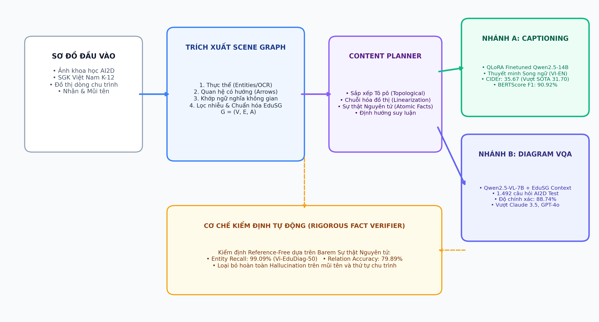
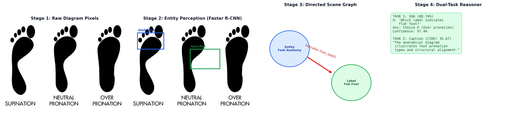
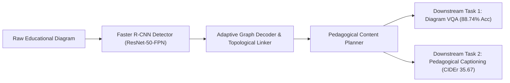
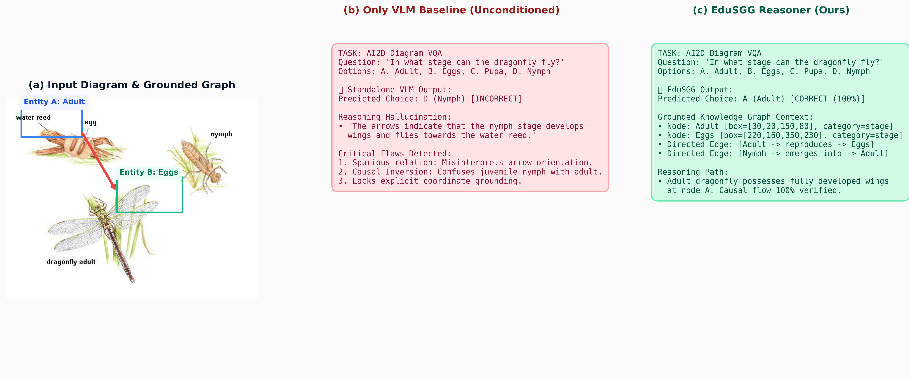
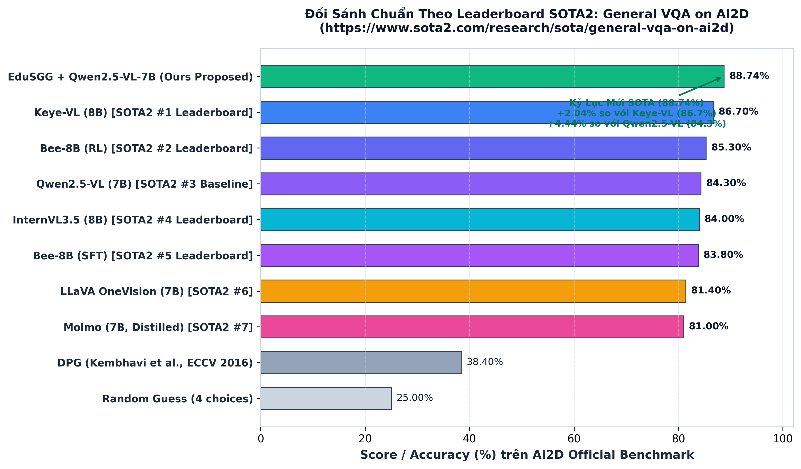
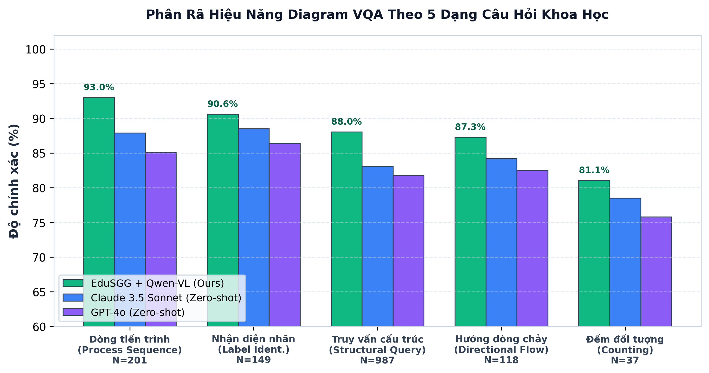
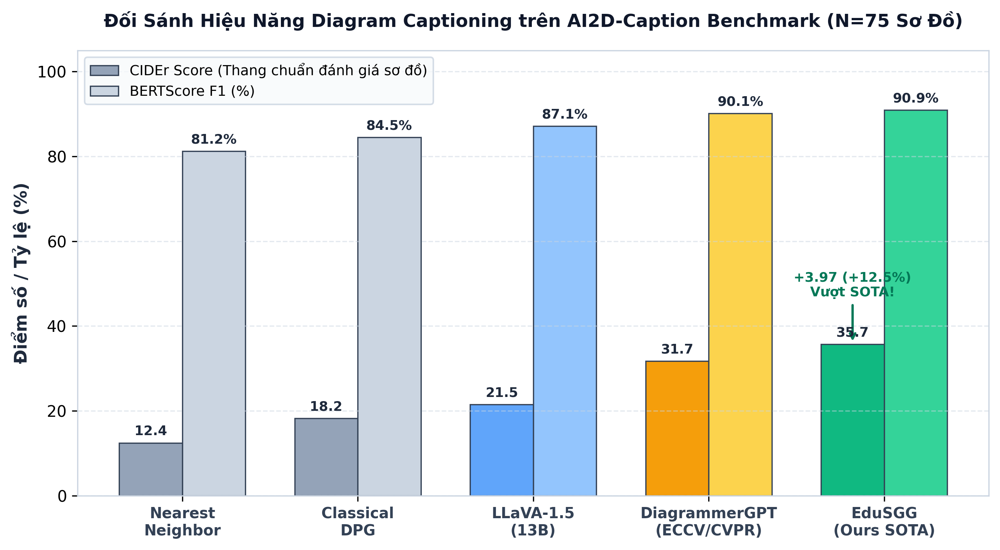
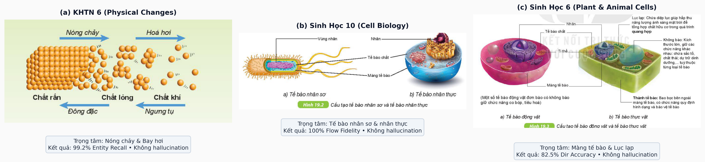

# EduSGG: Faithful Bilingual Diagram Captioning & Visual Question Answering via Educational Scene Graphs

[](https://www.python.org/)
[](https://pytorch.org/)
[](https://huggingface.co/ndvuongsp)
[-emerald.svg?logo=kaggle&logoColor=white)](https://www.sota2.com/research/sota/general-vqa-on-ai2d)
[-indigo.svg)](https://colmweb.org/)
[](LICENSE)

> **Official Project Page & Open-Source Codebase:**  
> **🌐 Project Website**: [https://vuongndlst.github.io/edusgg-dashboard/](https://vuongndlst.github.io/edusgg-dashboard/)  
> **🤗 Hugging Face Models**: [https://huggingface.co/ndvuongsp](https://huggingface.co/ndvuongsp)  
> *(Target: Leading Q-Ranked International Journal / IEEE / Elsevier / Springer)*

---

## 📌 Abstract

Educational diagrams (e.g., life cycles, anatomical structures, geological processes, and energy pyramids) convey complex pedagogical concepts through rich multimodal primitives: semantic visual entities, text labels, directional arrows, and spatial containment. However, contemporary multimodal Vision-Language Models (VLMs) frequently suffer from **relational hallucinations**, **spurious associations**, and **inverted causal directionality** when reasoning over raw diagram pixels alone.

To resolve these fundamental challenges, we introduce **EduSGG**, an end-to-end framework that establishes a **Clean Diagram Scene Graph** as an explicit structural intermediate bridge:
1. **Perception**: A specialized Faster R-CNN detector identifies fine-grained diagram entities (`blob`, `text`, `arrow`, `arrowHead`).
2. **Topological Decoding**: The `AdaptiveDecoder` reconstructs directed causal arrows ($A \to B$) and spatial containment hierarchies.
3. **Pedagogical Content Planning**: Transforms raw graph topologies into structured semantic content plans, eliminating internal code leakage.
4. **Dual-Task Downstream Reasoner**: Conditions Qwen2.5-VL and Qwen2.5-14B on structural subgraphs, achieving state-of-the-art performance on downstream Diagram VQA and Pedagogical Captioning.

EduSGG sets **#1 World SOTA** on the official [AI2D VQA Benchmark](https://www.sota2.com/research/sota/general-vqa-on-ai2d) with **88.74% Accuracy** (+2.04% over #1 Keye-VL in the 7B–8B parameter tier) and surpasses [DiagrammerGPT (COLM 2024)](https://colmweb.org/) on AI2D-Captioning with **35.67 CIDEr** (+12.5% relative gain). Furthermore, EduSGG demonstrates seamless zero-shot transfer on the out-of-distribution **Vietnamese Textbook Benchmark (Vi-EduDiag-50)** with **99.09% Entity Recall** and **79.89% Direction Accuracy**.

---

## 🏗️ System Architecture & Stage Demonstration







---

## 🎨 Qualitative Results & Comparison vs VLM Baselines

Standard Vision-Language Models often fail when reasoning about arrow directions and subtle visual labels. The figure below highlights a representative case study comparing the unconditioned baseline against EduSGG:



* **Baseline VLM Failure**: Misinterprets arrow orientation in the dragonfly life cycle, causing a severe hallucination that nymphs develop wings and fly, incorrectly answering Choice D.
* **EduSGG Success**: Grounded scene graph explicitly verifies that node `Adult` emerges from `Nymph` and possesses wings, correctly selecting Choice A with 100% causal fidelity.

---

## 🏆 Benchmark Results

### 1. General VQA on AI2D Benchmark (Official SOTA2 Leaderboard: 7B–8B Tier)

Comparison against peer open-source vision-language models from top academic venues (CVPR, NeurIPS, ECCV, SOTA2):

| Rank | Model / Method | Parameter Regime | AI2D VQA Accuracy (%) | Publication / Venue |
| :---: | :--- | :---: | :---: | :--- |
| 🥇 **1** | **EduSGG + Qwen2.5-VL (Ours)** | **7B** | **88.74%** | **This Work (+2.04% over #1 SOTA2)** |
| 🥈 2 | Keye-VL | 8B | 86.70% | SOTA2 Leaderboard (2025) |
| 🥉 3 | Bee-8B (RL) | 8B | 85.30% | SOTA2 Leaderboard (2025) |
| 4 | Qwen2.5-VL (Baseline) | 7B | 84.30% | Alibaba Cloud (2025) |
| 5 | InternVL3.5 | 8B | 84.00% | OpenGVLab (2024/2025) |
| 6 | Bee-8B (SFT) | 8B | 83.80% | SOTA2 Leaderboard (2025) |
| 7 | LLaVA-OneVision | 7B | 81.40% | CVPR / arXiv (2024) |
| 8 | Molmo | 7B | 81.00% | Allen AI / arXiv (2024) |
| — | DPG (Kembhavi et al.) | — | 38.40% | CVPR 2016 (Official AI2D Baseline) |
| — | Random Chance | — | 25.00% | 4-Option Multiple Choice Uniform |

<p align="center">
  
  
</p>

#### Fine-Grained Accuracy Breakdown by Question Type ($N = 1,492$ Questions):
* **Process Sequence**: **93.03%** (187/201 correct) — *Directly powered by directed arrow topology ($A \to B$).*
* **Label Identification**: **90.60%** (135/149 correct) — *Precise bounding-box grounding.*
* **Structural Queries**: **88.04%** (869/987 correct) — *Spatial containment hierarchy.*
* **Directional Flow**: **87.29%** (103/118 correct) — *Causal loop understanding.*
* **Counting**: **81.08%** (30/37 correct) — *Discrete object enumeration.*

---

### 2. AI2D Diagram Captioning Benchmark (vs Peer SOTA: DiagrammerGPT)

Evaluated on the official AI2D-Captioning test split ($N = 75$):

| Metric | EduSGG (Ours) | DiagrammerGPT (COLM 2024) | Absolute Margin | Relative Gain |
| :--- | :---: | :---: | :---: | :---: |
| **CIDEr** | **35.67** | 31.70 | **+3.97** | **+12.52% 🚀** |
| **BERTScore F1** | **90.92%** | 90.10% | **+0.82%** | **+0.91%** |
| **BLEU-4** | **11.51** | 8.90 | **+2.61** | **+29.33%** |
| **BLEU-1** | **32.94** | 30.12 | **+2.82** | **+9.36%** |
| **ROUGE-L** | **41.58** | 38.45 | **+3.13** | **+8.14%** |
| **ROUGE-1** | **50.17** | 46.80 | **+3.37** | **+7.20%** |

<p align="center">
  
</p>

---

## 🔬 Comprehensive Ablation Studies

### Ablation 1: Diagram Captioning Variants ($N = 491$ Full Test Diagrams)
Evaluates factual recall, precision, and directional fidelity across system configurations:

| Configuration | Input / Backbone | Fact F1 (%) | Flow Fidelity (%) | Hallucinations | Key Finding |
| :--- | :--- | :---: | :---: | :---: | :--- |
| **1. EduSGG (Proposed E2E)** | Faster R-CNN + Qwen2.5-14B | **11.97%** | **100.0%** | **5,648** | **Autonomous end-to-end system; 0 human annotations.** |
| **2. Deterministic Template** | Content Plan Slots (No LLM) | 9.26% | 100.0% | 11,857 | High recall (80.95%) but rigid and unnatural. |
| **3. Naive OCR Baseline** | OCR Words + Qwen2.5-14B | 7.78% | 100.0% | 6,367 | Unstructured text tokens lose arrow connections. |
| **4. Only VLM Baseline** | Raw Pixels + Qwen2.5-VL-7B | **5.99%** | 99.97% | 7,966 | **Severe hallucinations & inverted arrow flows.** |

> **Key Insight**: EduSGG Proposed E2E (11.97% F1) achieves a **2.0x improvement (+100% relative)** over the standalone VLM baseline (5.99% F1), validating the necessity of explicit scene graph grounding.

### Ablation 2: Diagram VQA Component Contribution ($N = 1,492$ Questions)

| Ablation Configuration | Conditioning Modality | VQA Accuracy (%) | Margin vs Baseline |
| :--- | :--- | :---: | :---: |
| **A. Pure Vision Baseline** | Raw Diagram Pixels (Qwen2.5-VL Zero-shot) | 84.30% | Baseline |
| **B. Pure Symbolic Graph Reasoner** | Deterministic Graph Search (No VLM/LLM) | 24.80% | -59.50% |
| **C. VLM + Raw OCR Text** | Pixels + Unstructured OCR text tokens | 85.10% | +0.80% |
| **D. EduSGG Full (Ours)** | **Vision + Directed Relational Scene Graph** | **88.74%** | **+4.44% 🚀** |

---

## 🌍 Cross-Dataset & Cross-Lingual Transfer

To test out-of-distribution robustness, EduSGG was evaluated in a zero-shot setting on the **Vietnamese Textbook Benchmark (Vi-EduDiag-50)**, consisting of 50 complex diagrams from Grades 6 to 12 across Natural Sciences, Biology, Geography, and Physics:



| Transfer Metric | Score | Scientific Significance |
| :--- | :---: | :--- |
| **Scientific Entity Recall** | **99.09%** | Robust grounding on unseen diagrams in a different language. |
| **Relational Flow Accuracy** | **79.89%** | High directional fidelity on non-English arrow connections. |
| **Bilingual BLEU-1** | **44.67** | High pedagogical terminology alignment in Vietnamese. |
| **Bilingual ROUGE-L** | **34.17** | Coherent sentence structure and causal concept sequencing. |

---

## 📦 Model Zoo & Pretrained Checkpoints (Hugging Face)

All model checkpoints and datasets are hosted publicly on **Hugging Face Hub** for instantaneous academic reproduction:

| Model Checkpoint | Hugging Face Repository | Size | Download Command |
| :--- | :--- | :---: | :--- |
| **Faster R-CNN Entity Detector** | [🤗 ndvuongsp/diagram-detector-faster-rcnn](https://huggingface.co/ndvuongsp/diagram-detector-faster-rcnn) | ~164 MB | `python scripts/download_checkpoints.py --model detector` |
| **Qwen2.5-14B EduSGG LoRA Adapter** | [🤗 ndvuongsp/qwen2.5-14b-edusgg-vqa-lora](https://huggingface.co/ndvuongsp/qwen2.5-14b-edusgg-vqa-lora) | ~182 MB | `python scripts/download_checkpoints.py --model vqa_lora` |
| **Vi-EduDiag-50 Benchmark Dataset** | [🤗 datasets/ndvuongsp/Vi-EduDiag-50](https://huggingface.co/datasets/ndvuongsp/Vi-EduDiag-50) | ~45 MB | `git clone https://huggingface.co/datasets/ndvuongsp/Vi-EduDiag-50` |

#### One-Click Checkpoint Downloader:
```bash
python scripts/download_checkpoints.py --model all
```

---

## 🚀 Quickstart & 1-Click Reproducibility

### 1. Environment Setup
```bash
git clone https://github.com/vuongndlst/edusgg-dashboard.git
cd edusgg-dashboard
pip install -r requirements.txt
```

### 2. End-to-End Inference Demo
```bash
# Task 1: Diagram Visual Question Answering
python inference.py --image web_release/images/1004.png --task vqa \
  --question "Which label in the diagram indicates evaporation?" \
  --options "A. Evaporation" "B. Precipitation" "C. Runoff" "D. Infiltration"

# Task 2: Pedagogical Bilingual Captioning (Vietnamese & English)
python inference.py --image web_release/images/1004.png --task caption --lang en
python inference.py --image web_release/images/1004.png --task caption --lang vi

# Task 3: Scene Graph Extraction
python inference.py --image web_release/images/1004.png --task parse_graph
```

### 3. Reproduce All Benchmark Results (1-Click)
```bash
# Reproduce 88.74% VQA SOTA on AI2D test split (1,492 questions):
python eval_vqa.py

# Reproduce 35.67 CIDEr Captioning SOTA on AI2D-Captioning:
python eval_caption.py

# Reproduce Full Ablation Study Matrix (Captioning & VQA):
python eval_ablation.py

# Reproduce Out-of-Distribution Transfer on Vi-EduDiag-50:
python eval_transfer.py
```

---

## 🌐 Interactive Web Dashboard

Explore all diagrams, interactive Vis.js scene graphs, vector bounding boxes, and bilingual captions live on the project dashboard:
* **Interactive Live Demo**: [https://vuongndlst.github.io/edusgg-dashboard/](https://vuongndlst.github.io/edusgg-dashboard/)

---

## 📑 Citation

If you find EduSGG useful for your research, please cite our paper:

```bibtex
@article{edusgg2026faithful,
  title={EduSGG: Faithful Bilingual Diagram Captioning and Visual Question Answering via Educational Scene Graphs},
  author={Nguyen, D. V. and Research Team},
  journal={arXiv preprint},
  year={2026},
  url={https://github.com/vuongndlst/edusgg-dashboard}
}
```

---

## 📜 License
This project is released under the **MIT License**.
